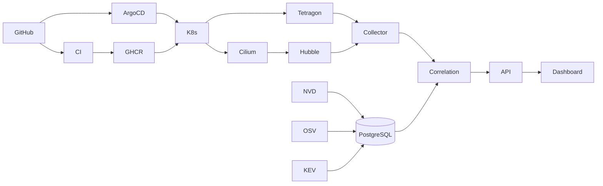

# Kubernetes eBPF Security Platform

기존 온프레미스 Kubernetes에서 공급망 보안, CVE 관리, eBPF 런타임 관측 및 Zero Trust 정책을 통합하는 프로젝트입니다.

## 시작하기
- 기존 CentOS, HAProxy, Docker, Calico, Argo CD 유지. AWS 및 신규 VM 불필요.
- Kubernetes 1.27 계열은 지원 종료 상태이므로 지원 버전으로의 업그레이드 및 커널 호환성 검증을 선행합니다.
- 제어 노드에서 `bash infra/preflight/cluster.sh`, 각 노드에서 `bash infra/preflight/node.sh` 실행. 출력은 로컬에만 보관합니다.
- [기술 명세](docs/technical-spec.md), [개발 지침](AGENTS.md), [마스터 프롬프트](docs/master-prompt.md), [로드맵](docs/roadmap.md), [운영 가이드](docs/runbooks/local-bootstrap.md).

## MVP
CVE 정규화 → SBOM 패키지 매칭 → 런타임 이벤트 정규화 → 근거 기반 위험도 → 읽기 전용 대시보드.
현재는 초기 스캐폴드이며 완성된 보안 제품이나 실제 배포 상태가 아닙니다.

Cilium 전환 및 정책 강제 적용은 별도 승인 후 진행합니다. 초기 CI는 클러스터에 접근하지 않습니다.
